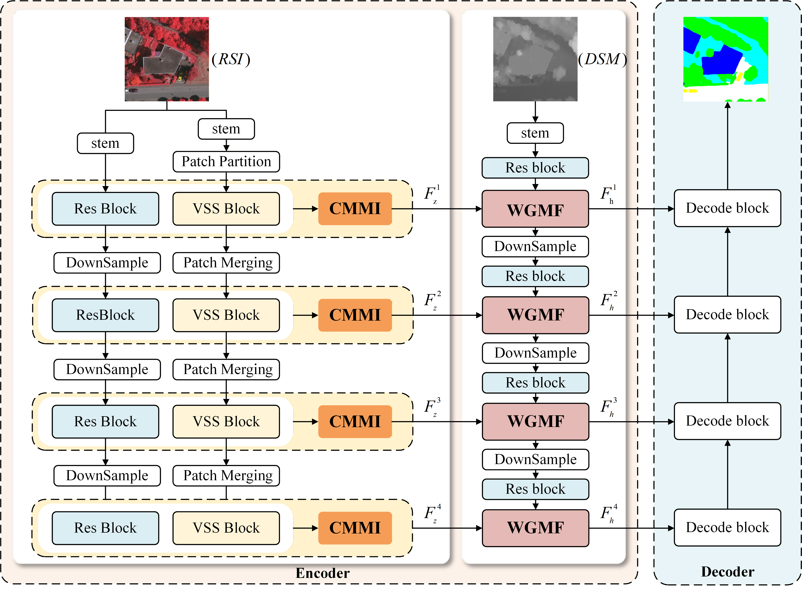

# M2GAFNet
Pytorch implementation for MMGAFNet 《MMGAFNet: Multi-Axis Mamba-Aided Graph Attention Fusion Network for Multimodal Semantic Segmentation of Remote Sensing Images》

The source code will be made public after the article is accepted.

